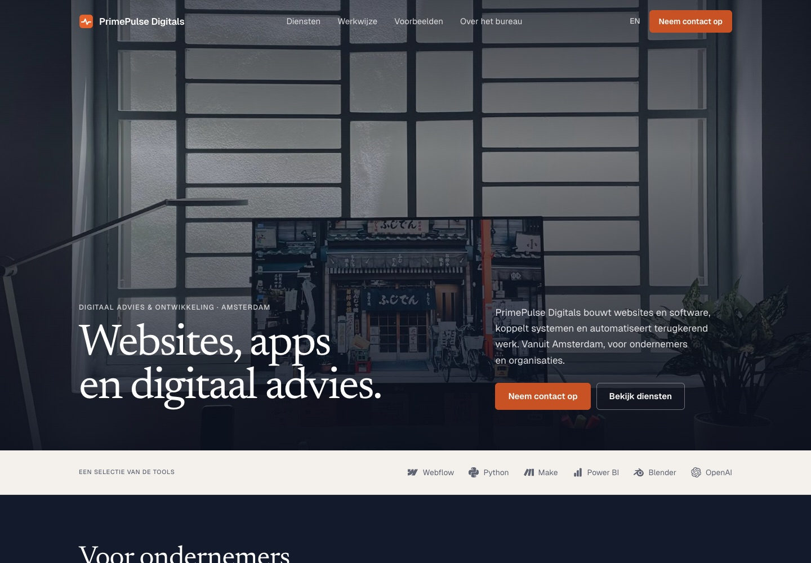
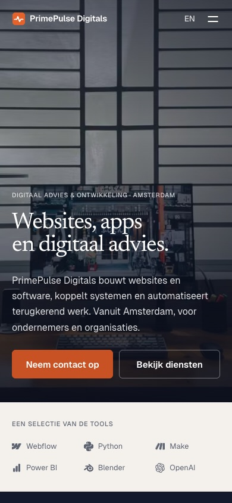

# PrimePulse Digitals website

**Type:** company website · own project
**Languages:** Dutch and English
**Year:** 2026

 

## Brief

A company website that shows what PrimePulse does within seconds, works well on every screen and stays fast without ongoing maintenance.

## Approach

- **Static, no frameworks.** HTML, CSS and a small amount of JavaScript, built with a single Node script. No third-party scripts; fonts are self-hosted.
- **Bilingual.** Dutch at `/`, English at `/en/`, with the same structure.
- **Privacy-friendly.** No cookies, no analytics, no tracking.
- **Accessible.** Fully keyboard-operable, respects the reduced-motion preference, and content stays visible without JavaScript.
- **Subtle motion.** Gentle photo movement on scroll, short section reveals and hover accents.

## Testing

Checked at six screen widths (320 to 1440 pixels): menu, keyboard focus, internal links and form validation. No script errors or missing assets.

## Stack

HTML · CSS · JavaScript · Node.js (build) · Netlify
